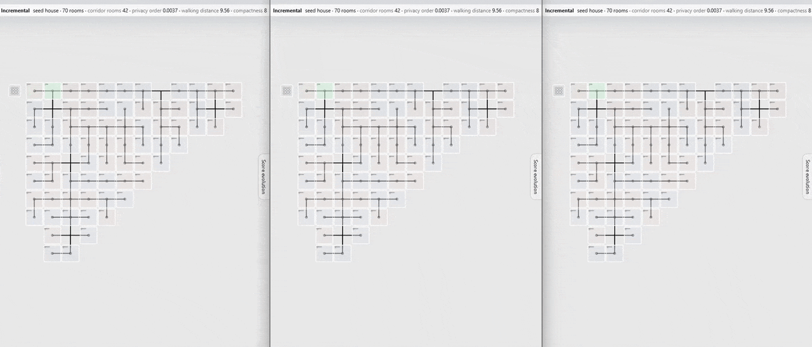
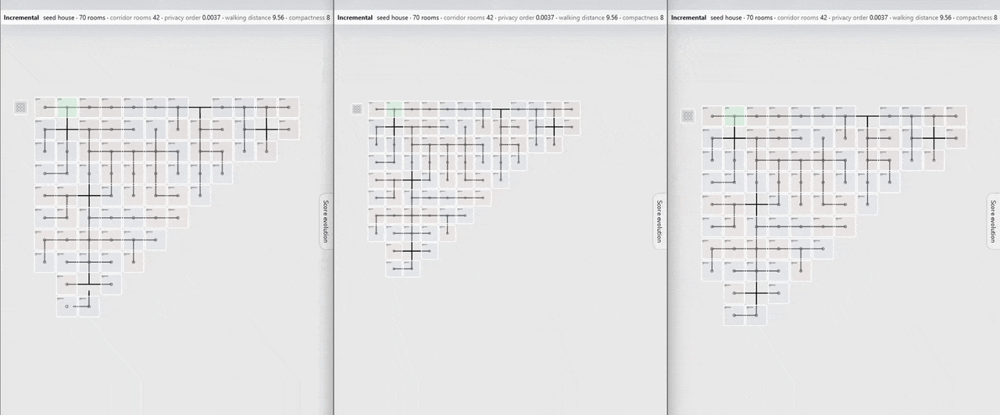
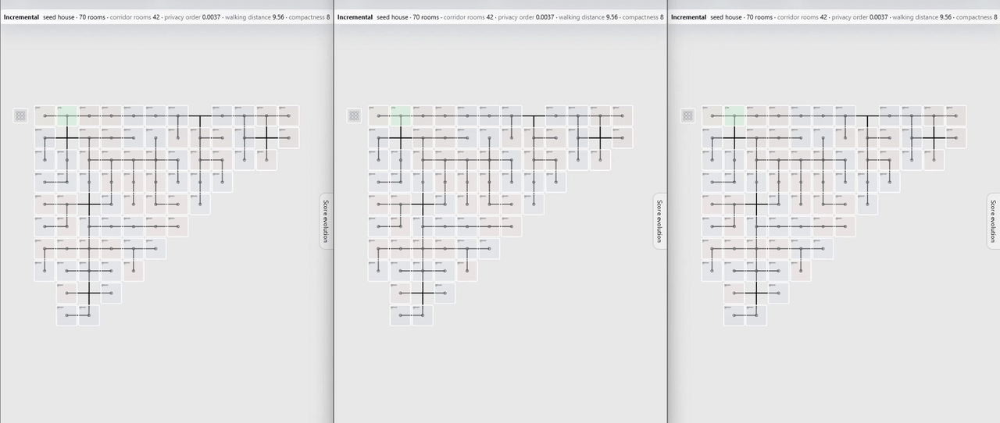

Here we show animations of the design strategies used by the agents as they construct the 100 room house.

These are screenshots of the viewer tool, and help build a stronger intuition for the products of this research.  

Each room is a square and the lines connecting them represent the doors. Lines without a square represent hallways.

## House 1 - reorganize / reorganize + cost / cost 

Three incremental step-by-step growth trajectories of the same base house (house #1 - a difficult seed) : 
- agent is asked to reduce complexity before adding new rooms (left)
- the same but introducing construction costs (middle)
- agent is told only about construction costs (right)

### Opus 5.5 medium 

### Deepseek 4.1 flash low 

### Sonnet 5.5 medium

