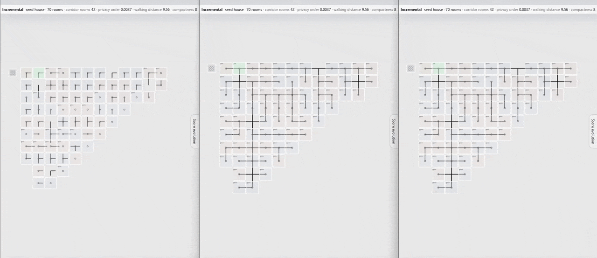

 Here we show animations of the design strategies used by the agents as they construct the 100-room house from a 70-room seed.

These are screenshots of the viewer tool, and help build a stronger intuition for the products of this research.  

Each room is a square and the lines connecting adjacent ones represent corridors through their shared doors. Lines without a square represent hallways.

## House 1 - default / simplify + cost / cost 

Three incremental step-by-step growth trajectories of the same base house (house #1 - a difficult seed) : 
- left: agent is asked simply to add new room, without any other explicit instruction about reconstruction or cost
- center: introducing request to reduce complexity before adding, plus awareness about construction costs
- right: agent is told only about construction costs

### Opus 5.5 medium 

### Deepseek 4.1 flash low 

### Sonnet 5.5 medium

## House 1 - reorganize only, using opus / deepseek / sonnet 

The incremental step-by-step growth trajectories of the same base house, when three different agents are asked to simplify it before adding a room : 

(left) opus 5.5 medium, (center) deepseek 41 flash low, (right) sonnet 5.5 medium

It's visible how eagerly Deepseek rebuilds, and how conservative Sonnet remains after the first rebuild. Opus is the balanced one.

